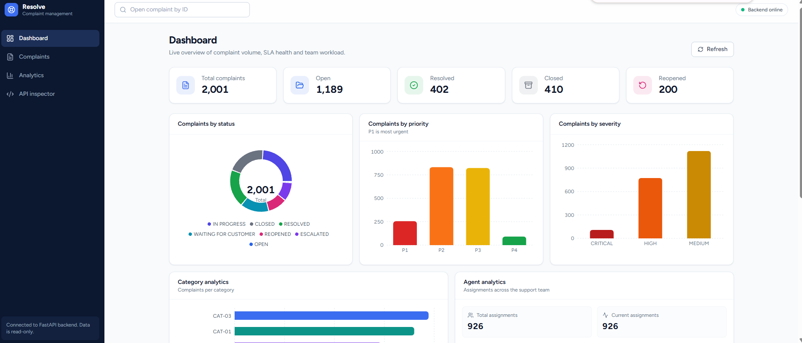
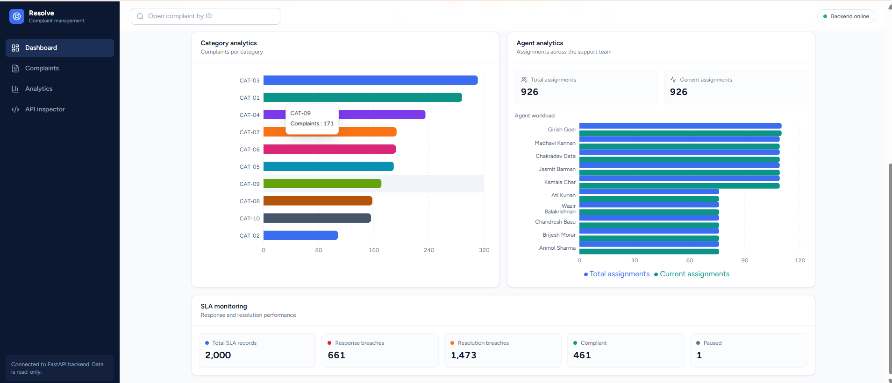
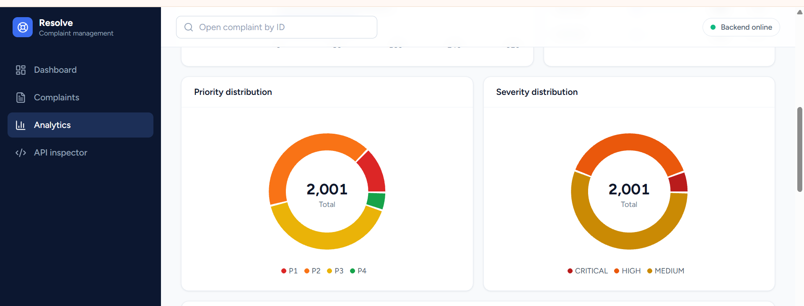
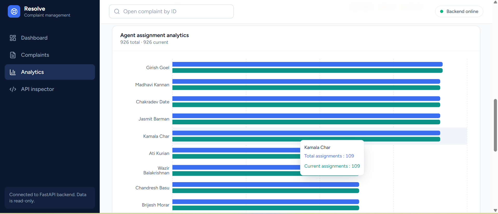
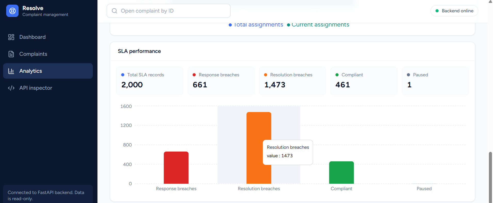

# Customer Complaint Management & Resolution System (CCMRS)

A full-stack Customer Complaint Management & Resolution System designed to centralize complaint tracking, monitor resolution progress, analyze operational performance, and evaluate Service Level Agreement (SLA) compliance.

The platform provides an interactive dashboard, complaint search and filtering, detailed complaint records, complaint lifecycle history, agent assignment analytics, and SLA monitoring through a React frontend and FastAPI backend connected to Neon PostgreSQL.

---

## 📸 Application Screenshots

### 1. Dashboard

The dashboard provides an overview of complaint operations through key performance indicators, complaint statistics, and analytical visualizations.





### 2. Analytics

The analytics section provides insights into complaint distribution, operational performance, and SLA-related metrics.








---

## ✨ Key Features

### Dashboard & Analytics

- **Centralized Dashboard:** Displays total, open, resolved, closed, and reopened complaint statistics.
- **Status Analysis:** Visualizes complaint distribution across different lifecycle statuses.
- **Priority Analysis:** Provides insights into complaint priority distribution.
- **Severity Analysis:** Displays complaint severity distribution.
- **Category Analytics:** Analyzes complaints across different categories.
- **Agent Analytics:** Provides agent assignment statistics and current assignment information.
- **SLA Monitoring:** Displays response and resolution SLA performance, including breach indicators.

### Complaint Management

- **Complaint Search:** Search complaint records by complaint ID or complaint description.
- **Dynamic Filtering:** Filter complaints by status, priority, severity, and channel.
- **Pagination:** Retrieve complaint records efficiently using limit and offset.
- **Complaint Details:** View detailed complaint and customer information.
- **Assignment History:** Review historical team and agent assignments.
- **Communication History:** Access customer and agent messages.
- **Resolution Tracking:** Review resolution records and outcomes.
- **Status Timeline:** Track complaint status changes through historical records.

### SLA Tracking

- Monitor response and resolution deadlines.
- Track first response and resolution timestamps.
- Identify response and resolution SLA breaches.
- Monitor paused SLA clocks.
- Review SLA pause and resume events.

### Backend & Data Management

- **REST API:** FastAPI endpoints for dashboard reporting, analytics, complaint search, and complaint details.
- **Database Integration:** Neon PostgreSQL connectivity using the `pg8000` driver.
- **SQL-Based Retrieval:** Dynamic SQL queries for filtering and retrieving operational data.
- **Structured Data Generation:** Python-based generation of customer, product, order, complaint, and operational datasets.
- **Relational Data Model:** Maintains relationships between complaints, customers, assignments, messages, resolutions, and SLA records.

---

## 🛠️ Technology Stack

| Layer | Technologies |
|---|---|
| Frontend | React, TypeScript, Vite |
| Styling | Tailwind CSS |
| API Communication | Axios |
| Data Visualization | Recharts |
| Icons | Lucide React |
| Backend | Python, FastAPI |
| Database | Neon PostgreSQL |
| Database Driver | pg8000 |
| API Documentation | Swagger / OpenAPI |
| Version Control | Git, GitHub |

---

## 🏗️ System Architecture

```text
                         USER
                           |
                           v
                    REACT FRONTEND
                    (Vite + TypeScript)
                           |
                           |
                     REST API Requests
                           |
                           v
                    FASTAPI BACKEND
                           |
                           |
                     SQL Queries
                           |
                           v
                  DATABASE CONNECTION
                       (pg8000)
                           |
                           v
                   NEON POSTGRESQL
                           |
             +-------------+-------------+
             |             |             |
             v             v             v
         CUSTOMERS     COMPLAINTS       AGENTS
                           |
             +-------------+-------------+
             |             |             |
             v             v             v
          MESSAGES     ASSIGNMENTS   STATUS HISTORY
             |             |             |
             +-------------+-------------+
                           |
                           v
                       RESOLUTIONS
                           |
                           v
                      SLA TRACKING
                           |
                           v
                       SLA EVENTS
```

### Application Data Flow

1. The user interacts with the React frontend.
2. The frontend sends HTTP requests to the FastAPI backend.
3. FastAPI processes the request and executes SQL queries.
4. The database connection layer communicates with Neon PostgreSQL.
5. PostgreSQL returns the requested records.
6. FastAPI converts the results into JSON responses.
7. The frontend displays the information through tables, charts, and complaint detail views.

---

## 📂 Project Structure

```text
Customer Complaint Management & Resolution System/
│
├── backend/
│   │
│   ├── data_generation/
│   │   ├── generators/
│   │   └── db_connection.py
│   │
│   ├── main.py
│   ├── inspect_api_schema.py
│   ├── requirements.txt
│   ├── .env
│   └── venv/
│
├── frontend/
│   │
│   ├── src/
│   │   ├── components/
│   │   ├── pages/
│   │   ├── services/
│   │   ├── types/
│   │   ├── App.tsx
│   │   └── main.tsx
│   │
│   ├── public/
│   ├── .env
│   ├── package.json
│   └── vite.config.ts
│
├── screenshots/
│   ├── dashboard.png
│   ├── dashboard01.png
│   ├── analytics.png
│   ├── analytics01.png
│   ├── analytics02.png
│   └── analytics03.png
│
├── README.md
└── ARCHITECTURE.md
```

---

## 🗄️ Database Design

The application uses Neon PostgreSQL as its relational database to store customer information, complaint records, operational activities, and SLA-related data.

### Main Database Tables

| Table | Purpose |
|---|---|
| customers | Stores customer information and customer attributes |
| products | Stores product information |
| orders | Maintains customer order records |
| order_items | Stores individual items associated with orders |
| complaints | Central complaint records and classification information |
| agents | Stores customer support agent information |
| teams | Maintains support team information |
| complaint_messages | Stores customer and agent conversations |
| complaint_assignments | Maintains complaint assignment history |
| complaint_status_history | Records complaint status transitions |
| resolutions | Stores resolution records and outcomes |
| sla_clocks | Tracks SLA deadlines, pauses, and breach indicators |
| sla_events | Stores SLA event history |
| surveys | Stores customer feedback and ratings |

The `complaints` table acts as the central entity connecting customer information, order references, complaint classification, communication history, assignments, resolution records, and SLA tracking.

---

## 🔄 Complaint Lifecycle Tracking

The system maintains complaint status information and historical transitions.

The generated dataset includes the following complaint statuses:

| Status | Description |
|---|---|
| IN_PROGRESS | Complaint is being investigated or handled |
| WAITING_FOR_CUSTOMER | Additional information is required from the customer |
| ESCALATED | Complaint requires escalation |
| RESOLVED | A resolution has been recorded |
| CLOSED | Complaint handling has been completed |
| REOPENED | A previously resolved or closed complaint has been reopened |

Complaint status changes are recorded in the `complaint_status_history` table, allowing the system to display the historical progression of each complaint.

---

## ⏱️ SLA Monitoring

The application tracks Service Level Agreement performance using dedicated SLA records and event history.

### SLA Information

- Response deadlines
- Resolution deadlines
- First response timestamps
- Resolution timestamps
- Response SLA breach indicators
- Resolution SLA breach indicators
- SLA pause status
- Total paused duration
- SLA pause and resume event history

The `sla_clocks` table maintains SLA timing information, while `sla_events` stores related operational events.

These records help identify delayed complaints and analyze service performance.

---

## 🚀 Installation & Setup

### Prerequisites

- Python 3.10+
- Node.js and npm
- Git
- Neon PostgreSQL database

### 1. Clone the Repository

```bash
git clone <your-github-repository-url>
cd "Customer Complaint Management & Resolution System"
```

### 2. Backend Setup

Navigate to the backend directory:

```powershell
cd backend
```

Create a Python virtual environment:

```powershell
python -m venv venv
```

Activate the virtual environment:

```powershell
.\venv\Scripts\Activate.ps1
```

Install the required dependencies:

```powershell
python -m pip install -r requirements.txt
```

### 3. Configure Database Connection

Create a `.env` file inside the `backend` directory:

```env
DATABASE_URL=your_neon_postgresql_connection_string
```

The database connection is configured through:

`backend/data_generation/db_connection.py`

Make sure the connection string points to your Neon PostgreSQL database.

### 4. Start the FastAPI Backend

From the backend directory, run:

```powershell
python -m uvicorn main:app --reload
```

Backend URL:

`http://127.0.0.1:8000`

Swagger API documentation:

`http://127.0.0.1:8000/docs`

### 5. Frontend Setup

Open a new terminal and navigate to the frontend directory:

```powershell
cd frontend
```

Install frontend dependencies:

```powershell
npm install
```

Create a `.env` file inside the frontend directory:

```env
VITE_API_BASE_URL=http://127.0.0.1:8000
```

Start the frontend development server:

```powershell
npm run dev
```

Frontend URL:

`http://localhost:5173`

**CORS Configuration:** When running the Vite development server on port 5173, configure FastAPI to allow:

- `http://localhost:5173`
- `http://127.0.0.1:5173`

---

## 🔌 REST API Endpoints

The FastAPI backend currently provides the following GET endpoints.

### Health Check

| Method | Endpoint | Description |
|---|---|---|
| GET | `/api/health` | Checks API and database connectivity |

### Dashboard APIs

| Method | Endpoint | Description |
|---|---|---|
| GET | `/api/dashboard/summary` | Retrieves overall complaint statistics |
| GET | `/api/dashboard/status` | Retrieves complaint status distribution |
| GET | `/api/dashboard/priority` | Retrieves priority-wise complaint distribution |
| GET | `/api/dashboard/severity` | Retrieves severity-wise complaint distribution |
| GET | `/api/dashboard/sla` | Retrieves SLA performance statistics |

### Analytics APIs

| Method | Endpoint | Description |
|---|---|---|
| GET | `/api/analytics/categories` | Retrieves category-wise complaint statistics |
| GET | `/api/analytics/agents` | Retrieves agent assignment analytics |

### Complaint APIs

| Method | Endpoint | Description |
|---|---|---|
| GET | `/api/complaints` | Retrieves, searches, and filters complaint records |
| GET | `/api/complaints/{complaint_id}` | Retrieves detailed information about a specific complaint |

### Complaint Search & Pagination

The `/api/complaints` endpoint supports the following query parameters:

| Parameter | Description |
|---|---|
| `search` | Searches by complaint ID or complaint description |
| `status` | Filters complaints by status |
| `priority` | Filters complaints by priority |
| `severity` | Filters complaints by severity |
| `channel` | Filters complaints by channel |
| `limit` | Maximum number of records to retrieve (up to 200) |
| `offset` | Number of records to skip |

Example request:

```http
GET /api/complaints?priority=P1&status=IN_PROGRESS&limit=20&offset=0
```

The complaint listing endpoint returns the total matching record count, pagination information, and complaint records.

### Complaint Details Response

The complaint details endpoint provides the following information:

- Complaint and customer details
- Complaint status history
- Team and agent assignment history
- Customer and agent messages
- Resolution records
- SLA clock information
- SLA event history

---

## 📖 API Documentation

Interactive API documentation is provided through FastAPI's automatically generated Swagger UI.

Open:

`http://127.0.0.1:8000/docs`

Developers can use Swagger UI to:

- Explore available REST API endpoints.
- Execute API requests.
- Inspect request parameters.
- Review JSON responses.
- Validate API behavior.

---

## 🔮 Future Enhancements

The following capabilities can be added to extend the current system:

- Complaint creation and update APIs.
- Agent assignment and reassignment workflows.
- Complaint status transition management.
- Customer and agent messaging functionality.
- Automated complaint prioritization.
- SLA breach notifications.
- Advanced complaint trend analysis.
- Customer satisfaction reporting.
- Role-based authentication and authorization.

---

## 👨‍💻 Project Information

**Project:** Customer Complaint Management & Resolution System (CCMRS)

**Architecture:** Full-stack REST API application

**Frontend:** React, TypeScript, Vite

**Backend:** Python, FastAPI

**Database:** Neon PostgreSQL

**Database Driver:** pg8000

**API Style:** REST

**Purpose:** Centralized complaint tracking, resolution monitoring, operational analytics, and SLA compliance monitoring.

